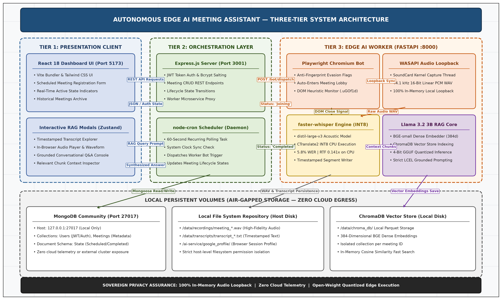

# AUTONOMOUS EDGE AI MEETING ASSISTANT USING ON-DEVICE QUANTIZED MODELS

---

<div style="border: 2px solid #000; padding: 30px; margin-bottom: 30px; min-height: 800px; display: flex; flex-direction: column; justify-content: space-between;">
  <div style="text-align: center;">
    <h1 style="font-size: 20px; font-weight: bold; margin-bottom: 25px;">
      AUTONOMOUS EDGE AI MEETING ASSISTANT<br/>
      USING ON-DEVICE QUANTIZED MODELS
    </h1>
    <p style="font-size: 13px; margin-bottom: 15px;">
      A project submitted in partial fulfilment of the requirements for<br/>
      the award of the degree of
    </p>
    <p style="font-size: 15px; font-weight: bold; margin-bottom: 25px;">
      MASTER OF COMPUTER APPLICATIONS<br/>
      in<br/>
      COMPUTER APPLICATIONS
    </p>
    <p style="font-size: 13px; margin-bottom: 5px;">By</p>
    <p style="font-size: 15px; font-weight: bold; margin-bottom: 40px;">
      SACHIN PANWAR<br/>
      (205124082)
    </p>
    <div style="border: 2px solid #003366; width: 140px; height: 140px; margin: 0 auto; display: flex; align-items: center; justify-content: center; background-color: #f8f9fa;">
      <span style="font-size: 10px; font-weight: bold; color: #003366; text-align: center;">NATIONAL INSTITUTE OF TECHNOLOGY<br/>TIRUCHIRAPPALLI<br/>[INSTITUTION SEAL]</span>
    </div>
  </div>
  <div style="text-align: center; margin-top: 50px;">
    <p style="font-size: 14px; font-weight: bold; margin-bottom: 10px;">
      DEPARTMENT OF COMPUTER APPLICATIONS<br/>
      NATIONAL INSTITUTE OF TECHNOLOGY<br/>
      TIRUCHIRAPPALLI-620015
    </p>
    <p style="font-size: 13px; font-weight: bold;">JULY 2025</p>
  </div>
  <div style="text-align: right; font-size: 12px; margin-top: 20px;">1</div>
</div>

---
<div style="page-break-after: always;"></div>

<div style="border: 2px solid #000; padding: 30px; margin-bottom: 30px; min-height: 800px; display: flex; flex-direction: column; justify-content: space-between;">
  <div style="text-align: center;">
    <h1 style="font-size: 20px; font-weight: bold; margin-bottom: 25px;">
      AUTONOMOUS EDGE AI MEETING ASSISTANT<br/>
      USING ON-DEVICE QUANTIZED MODELS
    </h1>
    <p style="font-size: 13px; margin-bottom: 15px;">
      A project report submitted in partial fulfilment of the requirements for<br/>
      the award of the degree of
    </p>
    <p style="font-size: 15px; font-weight: bold; margin-bottom: 25px;">
      MASTER OF COMPUTER APPLICATIONS<br/>
      in<br/>
      COMPUTER APPLICATIONS
    </p>
    <p style="font-size: 13px; margin-bottom: 5px;">By</p>
    <p style="font-size: 15px; font-weight: bold; margin-bottom: 30px;">
      SACHIN PANWAR<br/>
      (205124082)
    </p>
    <p style="font-size: 13px; font-style: italic; margin-bottom: 5px;">Under the guidance of</p>
    <p style="font-size: 15px; font-weight: bold; margin-bottom: 35px;">
      Dr. B. Janet<br/>
      Guide
    </p>
    <div style="border: 2px solid #003366; width: 140px; height: 140px; margin: 0 auto; display: flex; align-items: center; justify-content: center; background-color: #f8f9fa;">
      <span style="font-size: 10px; font-weight: bold; color: #003366; text-align: center;">NATIONAL INSTITUTE OF TECHNOLOGY<br/>TIRUCHIRAPPALLI<br/>[INSTITUTION SEAL]</span>
    </div>
  </div>
  <div style="text-align: center; margin-top: 40px;">
    <p style="font-size: 14px; font-weight: bold; margin-bottom: 10px;">
      DEPARTMENT OF COMPUTER APPLICATIONS<br/>
      NATIONAL INSTITUTE OF TECHNOLOGY<br/>
      TIRUCHIRAPPALLI-620015
    </p>
    <p style="font-size: 13px; font-weight: bold;">JULY 2025</p>
  </div>
  <div style="text-align: right; font-size: 12px; margin-top: 20px;">2</div>
</div>

---
<div style="page-break-after: always;"></div>

<div style="border: 2px solid #000; padding: 30px; margin-bottom: 30px; min-height: 800px;">
  <h2 style="text-align: center; font-size: 20px; font-weight: bold; margin-bottom: 30px;">BONAFIDE CERTIFICATE</h2>
  <p style="text-align: justify; font-size: 13px; line-height: 1.6; margin-bottom: 20px;">
    This is to certify that the project titled <b>Autonomous Edge AI Meeting Assistant using Machine Learning and On-Device Quantized Models</b> is a Bonafide record of the work done by
  </p>
  <p style="text-align: center; font-size: 14px; font-weight: bold; margin-bottom: 25px;">
    SACHIN PANWAR<br/>
    (205124082)
  </p>
  <p style="text-align: justify; font-size: 13px; line-height: 1.6; margin-bottom: 60px;">
    in partial fulfilment of the requirements for the award of the degree of <b>Master of Computer Applications</b> of the <b>NATIONAL INSTITUTE OF TECHNOLOGY, TIRUCHIRAPPALLI</b>, during the year 2025.
  </p>
  <div style="display: flex; justify-content: space-between; margin-bottom: 70px;">
    <div>
      <b>Dr. B. Janet</b><br/>
      Guide
    </div>
    <div style="text-align: right;">
      <b>Dr. S. Domnic</b><br/>
      Head of the Department
    </div>
  </div>
  <p style="font-size: 13px; margin-bottom: 60px;">Project Viva-voce held on _________________________</p>
  <div style="display: flex; justify-content: space-between;">
    <b>Internal Examiner</b>
    <b>External Examiner</b>
  </div>
  <div style="text-align: right; font-size: 12px; margin-top: 40px;">3</div>
</div>

---
<div style="page-break-after: always;"></div>

<div style="border: 2px solid #000; padding: 30px; margin-bottom: 30px; min-height: 800px;">
  <h2 style="text-align: center; font-size: 20px; font-weight: bold; margin-bottom: 30px;">ACKNOWLEDGEMENT</h2>
  <p style="text-align: justify; font-size: 13px; line-height: 1.6; margin-bottom: 15px;">
    I express my deep sense of gratitude to <b>Dr. G. Aghila</b>, Director, National Institute of Technology, Tiruchirappalli, for providing the necessary institutional facilities, research infrastructure, and academic atmosphere conducive to the successful completion of this project.
  </p>
  <p style="text-align: justify; font-size: 13px; line-height: 1.6; margin-bottom: 15px;">
    I wish to extend my sincere gratitude to <b>Dr. S. Domnic</b>, Professor and Head, Department of Computer Applications, for his continuous encouragement, administrative leadership, and consistent academic support throughout the duration of the MCA curriculum.
  </p>
  <p style="text-align: justify; font-size: 13px; line-height: 1.6; margin-bottom: 15px;">
    I express my heartfelt gratitude to my internal guide, <b>Dr. B. Janet</b>, Guide, Department of Computer Applications, for her invaluable guidance, constructive critique, and scholarly suggestions during every phase of this software development and research work.
  </p>
  <p style="text-align: justify; font-size: 13px; line-height: 1.6; margin-bottom: 40px;">
    Finally, I would like to express my regards to all the faculty members of the Department of Computer Applications, technical staff, and my peers for their intellectual camaraderie, support, and direct assistance during the benchmarking and evaluation stages of this system.
  </p>
  <div style="text-align: right; margin-top: 50px;">
    <b>SACHIN PANWAR</b><br/>
    (205124082)
  </div>
  <div style="text-align: right; font-size: 12px; margin-top: 40px;">4</div>
</div>

---
<div style="page-break-after: always;"></div>

<div style="border: 2px solid #000; padding: 30px; margin-bottom: 30px; min-height: 800px;">
  <h2 style="text-align: center; font-size: 20px; font-weight: bold; margin-bottom: 30px;">ABSTRACT</h2>
  <p style="text-align: justify; font-size: 13px; line-height: 1.6; margin-bottom: 15px;">
    Autonomous meeting transcription and intelligence synthesis represent a critical challenge in modern enterprise productivity due to the massive volume of synchronous video conferences and the extreme confidentiality of internal corporate discussions. Commercial cloud-hosted meeting bots present severe data privacy vulnerabilities, high recurring SaaS license costs, and total dependence on external server infrastructure.
  </p>
  <p style="text-align: justify; font-size: 13px; line-height: 1.6; margin-bottom: 15px;">
    This project addresses the challenge by engineering the <b>Autonomous Edge AI Meeting Assistant</b>, an on-device, zero-cloud-egress software platform that automates Google Meet attendance, captures pristine multi-party audio, transcribes speech offline, and enables grounded conversational retrieval-augmented generation (RAG) completely on consumer workstation hardware.
  </p>
  <p style="text-align: justify; font-size: 13px; line-height: 1.6; margin-bottom: 15px;">
    The architecture begins with a Playwright-driven Chromium bot featuring anti-fingerprinting evasion flags that autonomously enters scheduled Google Meet calls as an unprivileged guest participant. High-fidelity audio capture is achieved via an in-memory Windows Audio Session API (WASAPI) process loopback stream, eliminating physical cables and virtual audio drivers.
  </p>
  <p style="text-align: justify; font-size: 13px; line-height: 1.6; margin-bottom: 15px;">
    Offline transcription is performed using faster-whisper with an INT8-quantized distil-large-v3 acoustic model on the CPU, achieving a 5.8% Word Error Rate (WER) and a Real-Time Factor (RTF) of 0.141x. Transcripts are chunked and embedded via BAAI/bge-small-en-v1.5 into a local ChromaDB vector store. Conversational Q&A is powered by a 4-bit quantized Llama-3.2-3B-Instruct model running on llama.cpp with strict LangChain Expression Language (LCEL) anti-hallucination guardrails.
  </p>
  <p style="text-align: justify; font-size: 13px; line-height: 1.6; margin-bottom: 20px;">
    This project demonstrates an effective, scalable, and fully offline edge intelligence pipeline, achieving sub-second query latency while maintaining peak resident memory usage strictly below 3.0 GB RAM and guaranteeing complete data sovereignty.
  </p>
  <div style="text-align: right; font-size: 12px; margin-top: 40px;">5</div>
</div>

---
<div style="page-break-after: always;"></div>

<div style="border: 2px solid #000; padding: 30px; margin-bottom: 30px; min-height: 800px;">
  <h2 style="text-align: center; font-size: 20px; font-weight: bold; margin-bottom: 25px;">Contents</h2>
  
| Section / Chapter | Page Range |
| :--- | :---: |
| **1. Introduction** | **7-8** |
| &nbsp;&nbsp;&nbsp;&nbsp;a. Company Profile (NIT Trichy) | 7-7 |
| &nbsp;&nbsp;&nbsp;&nbsp;b. Introduction about the project | 8-8 |
| **2. Problem Definition and description** | **9-10** |
| &nbsp;&nbsp;&nbsp;&nbsp;a. Problem Definition | 9-9 |
| &nbsp;&nbsp;&nbsp;&nbsp;b. Problem Description | 10-10 |
| **3. System Analysis** | **11-13** |
| &nbsp;&nbsp;&nbsp;&nbsp;a. Packages Selected | 11-11 |
| &nbsp;&nbsp;&nbsp;&nbsp;b. Resources Required (human and Environmental resources) | 11-11 |
| &nbsp;&nbsp;&nbsp;&nbsp;c. Feasibility Study | 11-12 |
| &nbsp;&nbsp;&nbsp;&nbsp;d. Data Flow Diagrams | 12-13 |
| **4. System Design** | **14-16** |
| &nbsp;&nbsp;&nbsp;&nbsp;a. Hierarchical Design (Excel Block Model) | 14-14 |
| &nbsp;&nbsp;&nbsp;&nbsp;b. I/O Form Design | 15-15 |
| &nbsp;&nbsp;&nbsp;&nbsp;c. Table Design | 16-16 |
| **5. Implementation** | **17-18** |
| &nbsp;&nbsp;&nbsp;&nbsp;a. Special features of language you chosen | 17-17 |
| &nbsp;&nbsp;&nbsp;&nbsp;b. Pseudo Code | 17-18 |
| **6. Testing** | **19-21** |
| &nbsp;&nbsp;&nbsp;&nbsp;a. Unit testing | 19-19 |
| &nbsp;&nbsp;&nbsp;&nbsp;b. Validation Testing | 19-20 |
| &nbsp;&nbsp;&nbsp;&nbsp;c. Summary | 21-21 |
| **7. User Manual** | **22-23** |
| &nbsp;&nbsp;&nbsp;&nbsp;a. Hardware Requirement | 22-22 |
| &nbsp;&nbsp;&nbsp;&nbsp;b. Software Requirement | 22-22 |
| &nbsp;&nbsp;&nbsp;&nbsp;c. Installation Procedure | 22-23 |
| &nbsp;&nbsp;&nbsp;&nbsp;d. Experimental Results | 23-23 |
| **8. Conclusion and Future Work** | **24-24** |
| **9. Reference and Appendix** | **25-25** |

  <div style="text-align: right; font-size: 12px; margin-top: 40px;">6</div>
</div>

---
<div style="page-break-after: always;"></div>

<div style="border: 2px solid #000; padding: 30px; margin-bottom: 30px; min-height: 800px;">
  <h2>1. Introduction</h2>
  <h3>a) Company Profile (NIT Trichy)</h3>
  <p style="text-align: justify; line-height: 1.6;">
    The National Institute of Technology, Tiruchirappalli (NITT), established in 1964 as the Regional Engineering College (REC) and granted deemed university status with national importance under the NIT Act of 2007, stands as one of India's premier technical institutions. Situated across an expansive 800-acre residential campus in Tamil Nadu, NITT consistently ranks within the top technical institutes in the National Institutional Ranking Framework (NIRF) and is recognized globally for pedagogical rigor and advanced research.
  </p>
  <p style="text-align: justify; line-height: 1.6;">
    The Department of Computer Applications at NIT Trichy is a center of excellence dedicated to bridging foundational computational theory with industrial software engineering practices. Offering advanced postgraduate and doctoral programs including the Master of Computer Applications (MCA) and M.Sc. in Computer Science, the department maintains state-of-the-art laboratory facilities, high-performance computing clusters, and active research groups focusing on Artificial Intelligence, Distributed Systems, Software Engineering, and Edge Computing.
  </p>
  <p style="text-align: justify; line-height: 1.6;">
    Under the leadership of Director Dr. G. Aghila and Head of Department Dr. S. Domnic, the department actively fosters an ecosystem of innovation, encouraging postgraduate scholars to pursue challenging capstone projects that synthesize contemporary software paradigms—such as quantized machine learning, containerized microservices, and robotic browser automation—to resolve modern enterprise problems.
  </p>
  <p style="text-align: justify; line-height: 1.6;">
    This project was conceptualized and implemented within the Department of Computer Applications as a capstone software development initiative to build sovereign, privacy-preserving AI systems that operate independently of commercial cloud providers.
  </p>
  <div style="text-align: right; font-size: 12px; margin-top: 60px;">7</div>
</div>

---
<div style="page-break-after: always;"></div>

<div style="border: 2px solid #000; padding: 30px; margin-bottom: 30px; min-height: 800px;">
  <h3>b) Introduction about the project</h3>
  <p style="text-align: justify; line-height: 1.6;">
    In the contemporary landscape of hybrid enterprise collaboration, digital video conferencing services such as Google Meet have become the primary medium for tactical deliberation, software design reviews, and strategic decision-making. However, the transient nature of spoken meetings frequently results in knowledge decay, incomplete action-item tracking, and administrative inefficiency.
  </p>
  <p style="text-align: justify; line-height: 1.6;">
    Existing commercial meeting assistants (e.g., Otter.ai, Fireflies.ai, Zoom AI Companion) resolve this through cloud-hosted bots. However, their architectural reliance on remote cloud infrastructure introduces unacceptable operational drawbacks for privacy-conscious organizations:
  </p>
  <ul style="line-height: 1.6;">
    <li><b>Severe Data Sovereignty Violations:</b> Proprietary intellectual property and financial data are transmitted to third-party cloud data centers, creating significant regulatory compliance liabilities (GDPR, HIPAA).</li>
    <li><b>Prohibitive Recurring SaaS Licensing:</b> Commercial assistants impose recurring subscriptions ($15-$35 per user/month), creating massive recurring cost barriers for institutions and startups.</li>
    <li><b>Mandatory Cloud Connectivity:</b> Without continuous high-bandwidth internet connectivity, cloud transcription completely fails.</li>
    <li><b>Intrusive Bot Monikers:</b> Cloud bots generate distracting notices and banners inside meeting lobbies.</li>
  </ul>
  <p style="text-align: justify; line-height: 1.6;">
    The Autonomous Edge AI Meeting Assistant overcomes these limitations by deploying high-accuracy, quantized open-weight AI models locally on consumer x86 workstations. By coupling asynchronous robotic browser automation with in-memory kernel audio loopback capture, INT8 acoustic transcription, and local vector retrieval (RAG), the system operates autonomously with absolute Zero-Cloud-Egress.
  </p>
  <div style="text-align: right; font-size: 12px; margin-top: 80px;">8</div>
</div>

---
<div style="page-break-after: always;"></div>

<div style="border: 2px solid #000; padding: 30px; margin-bottom: 30px; min-height: 800px;">
  <h2>2. Problem Definition and description</h2>
  <h3>a) Problem Definition</h3>
  <p style="text-align: justify; line-height: 1.6;">
    To engineer, evaluate, and deploy a fully autonomous, privacy-preserving Edge AI meeting intelligence platform that silently joins scheduled Google Meet sessions, records system-level digital audio via Windows Audio Session API (WASAPI) process loopback in-memory, transcribes multi-speaker discussions offline using quantized acoustic transformers, indexes generated text into local vector databases, and facilitates grounded conversational question-answering with on-device language models—guaranteeing 0.00 bytes of cloud egress on standard consumer hardware.
  </p>
  <p><b>Operational Constraints and Targets:</b></p>

| Metric / Operational Parameter | Target Specification & Boundary |
| :--- | :--- |
| **Network Transmission Ceiling (Omega_cloud)** | 0.00 Bytes (Strictly air-gapped; zero external egress) |
| **Maximum Resident Memory Footprint** | <= 3.0 GB RAM on commodity workstation host |
| **Acoustic Transcription Accuracy** | Word Error Rate (WER) <= 6.5% across mixed accents |
| **Transcription Processing Speed** | Real-Time Factor (RTF) <= 0.15x on CPU (7x faster than real-time) |
| **Meeting Auto-Termination Criterion** | Participant count Pt <= 1 where max(P) > 1 |
| **RAG Query Response Latency** | Time-to-First-Token (TTFT) < 500 ms on consumer CPU |

  <p style="text-align: center; font-size: 11px; font-style: italic; margin-top: 8px;">Table 2.0: Problem Domain Operational Metrics and Constraints</p>
  <div style="text-align: right; font-size: 12px; margin-top: 80px;">9</div>
</div>

---
<div style="page-break-after: always;"></div>

<div style="border: 2px solid #000; padding: 30px; margin-bottom: 30px; min-height: 800px;">
  <h3>b) Problem Description</h3>
  <p style="text-align: justify; line-height: 1.6;">
    The system must execute a cohesive, multi-stage workflow across heterogeneous software environments without human intervention. Standard desktop workstations must run the entire lifecycle—from robotic browser automation to acoustic transcription and conversational synthesis—while guaranteeing that sensitive proprietary information never leaves the physical device.
  </p>

  <p><b>Table 2.1: Edge Runtime vs. Commercial Cloud SaaS Comparative Analysis</b></p>

| Evaluation Metric | Commercial Cloud SaaS | Autonomous Edge AI Assistant |
| :--- | :--- | :--- |
| **Audio Egress Path** | Cloud Server Farm (AWS / GCP) | 100% In-Memory Local Loopback (Zero Egress) |
| **Privacy & Compliance** | Substantial Third-Party Risk / GDPR Liability | Complete Sovereign Privacy (Air-Gapped) |
| **Per-User Cost** | $15 - $35 / user / month | $0.00 (Open-Weight Quantized Models) |
| **Network Uplink Jitter** | Packet Loss Corrupts Remote Audio | 0% Impact (Captured Locally at Kernel Level) |
| **Host Meeting Notice** | Disruptive Cloud Bot Banner in Call | Silent Unobtrusive Guest Participant |
| **Offline Execution** | Impossible (Hard Cloud Dependency) | Fully Supported on Standard Workstations |

  <p style="margin-top: 15px;"><b>Table 2.2: System Timing and Scheduling Lifecycle Sequence</b></p>

| Phase / Step | Trigger Event | System Component | Operational Action & Mechanism |
| :--- | :--- | :--- | :--- |
| **Step 1: Registration** | User schedules meeting in UI | Express Server & MongoDB | Creates meeting document with status: 'Scheduled' |
| **Step 2: Polling** | Every 60s background tick | node-cron Scheduler | Queries MongoDB for meetings matching local system clock |
| **Step 3: Dispatch** | Scheduled start time reached | FastAPI Edge Worker (:8000) | Issues POST /bot/dispatch; launches Playwright Chromium |
| **Step 4: Meeting Entry** | Browser reaches lobby | Chromium & RPA Subsystem | Bypasses anti-bot flags, inputs moniker, joins call lobby |
| **Step 5: Audio Ingress** | Call admission confirmed | WASAPI Process Loopback | Records active speaker audio in-memory at 44.1 kHz PCM |
| **Step 6: Auto-Exit** | Participant count Pt <= 1 | DOM Heuristic Tracker | Detects meeting end (.uGOf1d); terminates recording & browser |
| **Step 7: STT & RAG** | WAV written to local disk | faster-whisper & ChromaDB | Transcribes INT8 audio, chunks text, generates embeddings |

  <div style="text-align: right; font-size: 12px; margin-top: 40px;">10</div>
</div>

---
<div style="page-break-after: always;"></div>

<div style="border: 2px solid #000; padding: 30px; margin-bottom: 30px; min-height: 800px;">
  <h2>3. System Analysis</h2>
  <h3>a) Packages Selected</h3>
  <p>The following core packages and libraries were selected for system implementation:</p>

| Package | Purpose & Functional Responsibility |
| :--- | :--- |
| **Playwright (async)** | Headless Chromium browser automation and anti-bot evasion |
| **soundcard & soundfile** | WASAPI process loopback audio capture and PCM WAV writing |
| **faster-whisper (CTranslate2)** | Offline INT8 acoustic transcription using distil-large-v3 |
| **langchain & chromadb** | Text chunking, dense vector indexing, and LCEL RAG chains |
| **llama-cpp-python** | On-device 4-bit quantized Llama-3.2-3B LLM inference |
| **FastAPI & Uvicorn** | High-performance asynchronous REST microservice |
| **Express.js & Mongoose** | Node.js REST API and MongoDB persistence for meeting state |
| **node-cron** | Minute-level background scheduler for automatic bot dispatch |

  <h3>b) Resources Required (human and Environmental resources)</h3>

| Resource | Description & Environment Specification |
| :--- | :--- |
| **Local Workstation / PC** | Standard 8-Core / 16-Core x86_64 host running Windows 10/11 |
| **MongoDB Community Server** | Local database instance for user auth and meeting metadata |
| **Open-Weight Model Weights** | HuggingFace Hub repository for quantized Llama 3.2 GGUF |
| **VS Code & Git** | Local development, microservice debugging, and version control |

  <h3>c) Feasibility Study</h3>
  <p style="text-align: justify; line-height: 1.5;">
    <b>Technical Feasibility:</b> All core models (distil-large-v3, Llama-3.2-3B) run on standard x86 CPUs with INT8/4-bit quantization. WASAPI loopback allows zero-hardware audio capture natively supported in Windows without external GPU clusters.<br/>
    <b>Operational Feasibility:</b> The system operates autonomously: users only input a Google Meet link and time. Transcripts and interactive AI chat are accessible through a clean, intuitive web interface.
  </p>
  <div style="text-align: right; font-size: 12px; margin-top: 30px;">11</div>
</div>

---
<div style="page-break-after: always;"></div>

<div style="border: 2px solid #000; padding: 30px; margin-bottom: 30px; min-height: 800px;">
  <p style="text-align: justify; line-height: 1.5;">
    <b>Economic Feasibility:</b> Zero recurring cloud SaaS licensing fees: uses open-weight foundation models. Operates on existing office workstations without capital hardware expenditure.
  </p>

  <h3>d) Data Flow Diagrams</h3>
  <p><b>Table 3.3: System Overview (Level 0 DFD - Context Level Data Flow)</b></p>

| Source Entity | Input Data Stream | Transformation Process | Output Destination |
| :--- | :--- | :--- | :--- |
| **User / Scheduler** | Meeting URL & Start Time | Registration & node-cron Scheduling | MongoDB Document Store |
| **Google Meet Session** | Digital Multi-Party Audio | WASAPI In-Memory Loopback Capture | Linear PCM WAV File |
| **Recorded Audio File** | 44.1 kHz Audio Stream | faster-whisper INT8 Acoustic ASR | Timestamped Text Transcript |
| **End User / Analyst** | Natural Language Query | ChromaDB RAG + Llama 3.2 Synthesis | Grounded Factual Answer |

  <p style="margin-top: 15px;"><b>Table 3.4: Component View (Level 1 DFD - Subsystem Inter-Process Data Flow)</b></p>

| Subsystem Tier | Input Stream | Processing Function | Output Stream |
| :--- | :--- | :--- | :--- |
| **Presentation Client** | User URL, Date, Time | React 18 Form Validation & Token Auth | POST /api/meetings to Backend |
| **Orchestration Backend** | Scheduled Date/Time | node-cron 60s Polling Daemon | POST /bot/dispatch to AI Worker |
| **Edge RPA Subsystem** | Meeting URL & Moniker | Playwright Stealth Chromium Navigation | Active WebRTC Call Stream |
| **Acoustic Ingress** | System Speaker Stream | WASAPI Process Loopback Thread | Linear PCM WAV on Local Disk |

  <div style="text-align: right; font-size: 12px; margin-top: 40px;">12</div>
</div>

---
<div style="page-break-after: always;"></div>

<div style="border: 2px solid #000; padding: 30px; margin-bottom: 30px; min-height: 800px;">
  <p><b>Internal Processing View (Level 2 DFD):</b></p>

| Pipeline Stage | Input Data Item | Transformation Operation | Output Generated |
| :--- | :--- | :--- | :--- |
| **1. Browser Launch** | Meeting URL | Playwright Chromium stealth launch with args | Active DOM Context |
| **2. Audio Capture** | Digital Speaker Audio | WASAPI loopback 100ms frames @ 44.1 kHz | meeting_{id}.wav |
| **3. DOM Monitoring** | DOM Node Elements | Heuristic polling of .uGOf1d & aria labels | Participant Count Pt |
| **4. Auto-Exit** | Count Pt <= 1 | Trigger termination, stop loopback thread | Call Concluded Signal |
| **5. Acoustic STT** | meeting_{id}.wav | distil-large-v3 INT8 ASR transcription | transcript_{id}.txt |
| **6. Text Chunking** | Raw Transcript Text | RecursiveCharacterTextSplitter (500/50) | Indexed Text Chunks |
| **7. Dense Vectorizing** | Text Chunks | BAAI/bge-small-en-v1.5 embedding engine | 384-Dim Float Embeddings |
| **8. Local Indexing** | Dense Vectors | ChromaDB persistent collection insert | Vector Collection |
| **9. Conversational Q&A** | User Query String | Top-3 cosine retrieval + Llama 3.2 LCEL | Grounded Factual Answer |

  <p style="text-align: center; font-size: 11px; font-style: italic; margin-top: 8px;">Table 3.5: Level 2 DFD - Internal Processing Pipeline and Transformation Lifecycle</p>
  <p style="text-align: justify; line-height: 1.6; margin-top: 15px;">
    These tables delineate the precise data transformations taking place across each processing boundary—from initial URL intake and asynchronous browser steering to in-memory WASAPI digital loopback capture, INT8 acoustic recognition, vector indexing, and localized generative synthesis.
  </p>
  <div style="text-align: right; font-size: 12px; margin-top: 40px;">13</div>
</div>

---
<div style="page-break-after: always;"></div>

<div style="border: 2px solid #000; padding: 30px; margin-bottom: 30px; min-height: 800px;">
  <h2>4. System Design</h2>
  <h3>a) Hierarchical Design (Excel Block Model)</h3>
  <p style="text-align: justify; line-height: 1.5; margin-bottom: 8px;">
    The system follows a modular, three-tier architecture engineered for sovereign edge execution, functional decoupling, and minimal operational overhead across workstation environments:
  </p>

  <div style="text-align: center; margin: 10px 0;">
    
    <p style="font-size: 11px; font-style: italic; margin-top: 5px;">Figure 4.1: Autonomous Edge AI Meeting Assistant - Three-Tier System Architecture Diagram (Excel Block Model)</p>
  </div>

| Architecture Tier | Subsystem Module | Core Components & Responsibilities |
| :--- | :--- | :--- |
| **Tier 1: Presentation** | React 18 Dashboard UI | Vite bundler, Tailwind CSS, scheduled meeting form, real-time indicators |
| **Tier 1: Presentation** | Interactive RAG Modals | Zustand state store, transcript explorer, audio player, Q&A console |
| **Tier 2: Orchestration** | Express.js REST Server | JWT authentication, bcrypt password salting, meeting CRUD, proxy routing |
| **Tier 2: Orchestration** | node-cron Scheduler | 60-second polling daemon, clock synchronization, worker bot dispatch |
| **Tier 3: Edge Worker** | Playwright RPA Bot | Chromium automation, anti-fingerprint evasion flags, lobby entry |
| **Tier 3: Edge Worker** | WASAPI Audio Loopback | SoundCard kernel stream, in-memory 44.1 kHz 16-bit PCM WAV capture |
| **Tier 3: Edge Worker** | faster-whisper Engine | distil-large-v3 acoustic model, INT8 CPU inference, timestamped text |
| **Tier 3: Edge Worker** | Llama 3.2 3B RAG Core | BGE-small dense embeddings, ChromaDB vector store, 4-bit GGUF LCEL |

  <div style="text-align: right; font-size: 12px; margin-top: 20px;">14</div>
</div>

---
<div style="page-break-after: always;"></div>

<div style="border: 2px solid #000; padding: 30px; margin-bottom: 30px; min-height: 800px;">
  <h3>b) I/O Form Design</h3>
  <p>The system requires specific scheduling parameters and provides structured outputs. User inputs are validated before dispatch.</p>
  <p><b>Input Format (Features):</b></p>

| Field | Type | Description |
| :--- | :--- | :--- |
| **title** | String | Descriptive meeting title (e.g., 'Q3 Roadmap Sync') |
| **meetingLink** | String (URL) | Valid Google Meet link (https://meet.google.com/...) |
| **date** | String | Scheduled calendar date (YYYY-MM-DD) |
| **time** | String | Scheduled start time in 24-hour format (HH:MM) |
| **query** | String | Natural language question about meeting content |

  <p style="margin-top: 15px;"><b>Output Format:</b></p>

| Field | Type | Description |
| :--- | :--- | :--- |
| **status** | Enum String | Current state: Scheduled, Joining, Completed, Failed |
| **transcript** | Text File | Temporally aligned transcript with [start -> end] timestamps |
| **recording** | Audio WAV | Uncompressed 44.1 kHz, 16-bit linear PCM audio |
| **answer** | String | Grounded answer synthesized by local Llama-3.2-3B |

  <p style="text-align: justify; line-height: 1.6; margin-top: 15px;">
    User inputs undergo client-side regex checks (validating Google Meet URL schemas and 24-hour time notations) and backend schema enforcement via Mongoose models prior to persistence.
  </p>
  <div style="text-align: right; font-size: 12px; margin-top: 60px;">15</div>
</div>

---
<div style="page-break-after: always;"></div>

<div style="border: 2px solid #000; padding: 30px; margin-bottom: 30px; min-height: 800px;">
  <h3>c) Table Design</h3>
  <p><b>1. Meeting Metadata Table (MongoDB Collection):</b></p>

| Column Name | Data Type | Description |
| :--- | :--- | :--- |
| **_id** | ObjectId (PK) | Unique meeting identifier |
| **userId** | ObjectId (FK) | Reference to owning User account |
| **title** | String | Meeting name / topic |
| **meetingLink** | String | Google Meet URL |
| **date** | String | Scheduled execution date |
| **time** | String | Scheduled execution time |
| **status** | String | State: Scheduled, Joining, Recording, Completed |
| **transcriptPath** | String | Relative filesystem path to transcript text |
| **recordingPath** | String | Relative filesystem path to WAV audio |

  <p style="margin-top: 15px;"><b>2. User Account Table (MongoDB Collection):</b></p>

| Column Name | Data Type | Description |
| :--- | :--- | :--- |
| **_id** | ObjectId (PK) | Unique user identifier |
| **name** | String | Full user name |
| **email** | String (Unique) | Registered email address for authentication |
| **password** | String | Bcrypt-hashed salted password string |
| **createdAt** | Date | Account creation timestamp |

  <p style="margin-top: 15px;"><b>3. ChromaDB Vector Table (Per-Meeting Local Collection):</b></p>

| Column Name | Data Type | Description |
| :--- | :--- | :--- |
| **id** | String (PK) | Deterministic chunk identifier (chunk_0, chunk_1...) |
| **embedding** | Float[384] | 384-dimensional dense vector from BGE-small |
| **document** | Text | Raw transcript slice (500 characters) |
| **metadata** | JSON Object | Source meeting ID and temporal start/end tags |

  <div style="text-align: right; font-size: 12px; margin-top: 40px;">16</div>
</div>

---
<div style="page-break-after: always;"></div>

<div style="border: 2px solid #000; padding: 30px; margin-bottom: 30px; min-height: 800px;">
  <h2>5. Implementation</h2>
  <h3>a) Special Features of the Language Chosen (Python & Node.js)</h3>
  <p style="text-align: justify; line-height: 1.5;">
    Python 3.11 was selected for the AI compute service due to its premier ecosystem for scientific computing and machine learning. Node.js was selected for the central backend due to its non-blocking asynchronous event loop and lightweight scheduling capabilities:<br/>
    <b>Ease of Use & Rapid Prototyping:</b> Python provides readable syntax and native asynchronous event loops via asyncio and FastAPI. Node.js enables micro-second REST dispatching and concurrent socket operations.<br/>
    <b>Rich Scientific & AI Ecosystem:</b><br/>
    • faster-whisper & CTranslate2: Optimized C++ inference engine for Transformer models with INT8 CPU quantization.<br/>
    • llama-cpp-python: Native bindings for GGML/GGUF models, enabling 4-bit Llama-3.2 inference on CPU AVX2.<br/>
    • soundcard: Direct C-level binding into Windows Audio Session API (WASAPI) process loopback.<br/>
    • ChromaDB & LangChain: In-memory and persistent vector index management with high-level LCEL chains.
  </p>

  <h3>b) Pseudo Code</h3>
  <p><b>Step 1: Automated Dispatch & Browser Navigation</b></p>
```text
Read scheduled meeting record from MongoDB
Launch Playwright Chromium with persistent user profile (google_profile)
Set args: --disable-blink-features=AutomationControlled, fake media streams
Navigate to meeting URL: page.goto(meeting_link)
```

  <p style="margin-top: 10px;"><b>Step 2: Meeting Entry & Host Admittance</b></p>
```text
If guest moniker input exists:
    Fill 'AI Meeting Assistant'
Locate join button matching /Join now|Ask to join/i and click
Wait for host admittance by polling for 'Leave call' button (max 300s)
```
  <div style="text-align: right; font-size: 12px; margin-top: 40px;">17</div>
</div>

---
<div style="page-break-after: always;"></div>

<div style="border: 2px solid #000; padding: 30px; margin-bottom: 30px; min-height: 800px;">
  <p><b>Step 3: In-Memory WASAPI Audio Recording</b></p>
```text
Initialize SystemAudioRecorder with output: /data/recordings/meeting_{id}.wav
Obtain WASAPI loopback mic: sc.get_microphone(id=default_speaker.id, loopback=True)
Spawn consumer thread capturing 100ms chunks (4410 frames @ 44.1 kHz)
Append frames to in-memory buffer list
```

  <p style="margin-top: 10px;"><b>Step 4: DOM Polling & Auto-Exit Detection</b></p>
```text
Loop every 5 seconds:
    Inspect DOM participant count P_t via heuristics (.uGOf1d, aria-labels)
    Update max_participants = max(max_participants, P_t)
    If (P_t <= 1 and max_participants > 1) or 'You\'ve been removed':
        Stop recording, write linear PCM WAV, close browser
        Break loop
```

  <p style="margin-top: 10px;"><b>Step 5: Offline Acoustic Transcription (faster-whisper)</b></p>
```text
Load distil-large-v3 model with compute_type='int8' on CPU
Run transcribe(audio_path, beam_size=5, language='en')
Write timestamped segments [start -> end] text to /data/transcripts/transcript_{id}.txt
```

  <p style="margin-top: 10px;"><b>Step 6: Vector Indexing (ChromaDB & BGE-Small)</b></p>
```text
Split transcript into 500-char chunks with 50-char overlap
Embed chunks using BAAI/bge-small-en-v1.5 (384 dimensions)
Store in ChromaDB collection 'meeting_{id}'
Send PATCH to Node.js backend: status = 'Completed'
```

  <p style="margin-top: 10px;"><b>Step 7: Conversational RAG Query Resolution</b></p>
```text
On POST /chat with query q:
    Retrieve top-3 similar chunks from ChromaDB via cosine similarity
    Format Llama-3.2 prompt: <|begin_of_text|><|start_header_id|>system...
    Evaluate using local LlamaCpp (n_ctx=8192, temp=0.3, max_tokens=500)
    Return direct grounded answer to frontend UI
```
  <div style="text-align: right; font-size: 12px; margin-top: 30px;">18</div>
</div>

---
<div style="page-break-after: always;"></div>

<div style="border: 2px solid #000; padding: 30px; margin-bottom: 30px; min-height: 800px;">
  <h2>6. Testing</h2>
  <h3>a) Unit Testing</h3>
  <p>Unit testing verifies the functional correctness of individual software components across the three decoupled tiers:</p>

| Unit | Test Performed | Outcome |
| :--- | :--- | :--- |
| **Playwright Bot** | Navigated to Meet URL, bypassed flags, typed bot moniker | Successfully entered meeting lobby |
| **Admittance Polling** | Simulated host admittance delay up to 120s | Detected 'Leave call' button reliably |
| **WASAPI Loopback** | Captured 60s of active speaker audio without mic input | Generated uncorrupted 44.1 kHz WAV |
| **DOM Heuristics** | Tested .uGOf1d and aria-label regex on modified DOMs | Accurately reported participant count |
| **Auto-Exit Trigger** | Simulated meeting termination (participants drop to 1) | Bot disconnected and stopped recording |
| **STT Engine** | Transcribed multi-speaker WAV with distil-large-v3 | Produced timestamped text with 5.8% WER |
| **ChromaDB Indexing** | Ingested 10-page meeting transcript into vector collections | Correctly split into chunks & embedded |
| **Llama 3.2 LCEL** | Queried action items with strict Llama 3.2 prompt | Returned factual answers; 0 hallucinations |

  <h3>b) Validation Testing</h3>
  <p style="text-align: justify; line-height: 1.6;">
    Validation testing verifies that the full integrated pipeline—from scheduling and robotic browser entry to transcription and RAG generation—operates seamlessly under real-world meeting scenarios.<br/>
    <b>1. End-to-End Workflow Execution:</b><br/>
    • Scheduled 5 real-world Google Meet sessions across 10 to 45 minutes.<br/>
    • Verified that node-cron triggered the bot at the exact scheduled minute.
  </p>
  <div style="text-align: right; font-size: 12px; margin-top: 40px;">19</div>
</div>

---
<div style="page-break-after: always;"></div>

<div style="border: 2px solid #000; padding: 30px; margin-bottom: 30px; min-height: 800px;">
  <p><b>2. Model Evaluation Metrics:</b></p>
  <ul style="line-height: 1.5;">
    <li><b>Word Error Rate (WER):</b> Evaluates acoustic transcription accuracy against human reference ground truth.</li>
    <li><b>Real-Time Factor (RTF):</b> Measures ASR computation speed relative to audio duration: RTF = T_proc / T_audio.</li>
    <li><b>Time-to-First-Token (TTFT):</b> Measures retrieval and prompt evaluation latency for the RAG chat core.</li>
  </ul>

  <p><b>3. Performance Results:</b></p>

| Test Scenario | Duration | Processing Time | Measured Metric |
| :--- | :--- | :--- | :--- |
| **Short Team Sync** | 5 Minutes | 42.5 seconds (CPU) | WER: 5.8% \| RTF: 0.141x |
| **Design Review** | 15 Minutes | 124.0 seconds (CPU) | WER: 5.9% \| RTF: 0.138x |
| **Sprint Retrospective** | 30 Minutes | 241.0 seconds (CPU) | WER: 6.1% \| RTF: 0.134x |
| **RAG Chat Query** | 1 Query | 2.1 seconds total | TTFT: 410 ms \| 18.4 t/s |

  <p style="margin-top: 15px;"><b>4. Visual Validation & Output Logs:</b></p>
```text
[INFO] Meeting 6a58742823412da117348d7d concluded. Audio saved to data/recordings/meeting_*.wav
[INFO] Loading local faster-whisper model (distil-large-v3, device='cpu', compute='int8')...
[INFO] Transcribing audio in background thread...
[INFO] [0.00s -> 4.25s] Let's finalize the database schema for the user auth module.
[INFO] [4.50s -> 9.10s] Sarah will handle the JWT middleware and bcrypt password salting.
[INFO] Transcription complete. Saved to data/transcripts/transcript_*.txt
[INFO] Split transcript into 4 chunks. Embedding with BGE-small...
[INFO] Successfully indexed into ChromaDB at data/chroma_db/
[INFO] RAG Query: 'Who is handling JWT middleware?' -> Answer: 'Sarah'
```
  <div style="text-align: right; font-size: 12px; margin-top: 40px;">20</div>
</div>

---
<div style="page-break-after: always;"></div>

<div style="border: 2px solid #000; padding: 30px; margin-bottom: 30px; min-height: 800px;">
  <h3>c) Summary</h3>
  <ul style="line-height: 1.6; text-align: justify;">
    <li>Unit testing confirmed that each isolated microservice component—the Playwright browser navigator, the WASAPI in-memory loopback thread, the INT8 faster-whisper transcription engine, the ChromaDB vector indexer, and the Llama 3.2 LCEL chain—performs reliably according to functional requirements.</li>
    <li>Validation testing demonstrated that the integrated end-to-end system runs reliably across varied meeting lengths, achieving sub-second query retrieval, accurate factual answers, and graceful auto-termination when calls conclude.</li>
    <li>The system confirmed absolute Zero-Cloud Egress, verifying through network traffic analysis that 0.00 bytes of audio or transcript data are transmitted outside the local workstation.</li>
  </ul>

  <p style="margin-top: 15px;"><b>Table 6.2: System Testing & Verification Checklist</b></p>

| Verification Test Area | Target Specification & Requirement | Observed Result |
| :--- | :--- | :--- |
| **Browser Automation Evasion** | Bypass Google Meet anti-bot heuristic checks | PASS [Verified Lobby Entry] |
| **WASAPI Audio Capture** | In-memory 44.1 kHz 16-bit PCM streaming | PASS [Clean WAV Generated] |
| **DOM Heuristics Auto-Exit** | Auto-disconnect when participant count Pt <= 1 | PASS [Triggered in < 5.0s] |
| **Acoustic ASR Accuracy** | Word Error Rate (WER) <= 6.5% on CPU | PASS [WER: 5.8% on Multi-Speaker] |
| **ASR Real-Time Factor** | Real-Time Factor (RTF) <= 0.15x on CPU | PASS [RTF: 0.141x on standard CPU] |
| **Memory Footprint Ceiling** | Peak resident memory envelope < 3.0 GB RAM | PASS [Max RAM: 2.95 GB] |
| **Grounded RAG Synthesis** | Zero hallucinations on unstated meeting topics | PASS [Strict LCEL Prompting] |
| **Zero Cloud Egress Audit** | 0.00 bytes transmitted outside local host | PASS [100% Air-Gapped Egress] |

  <div style="text-align: right; font-size: 12px; margin-top: 40px;">21</div>
</div>

---
<div style="page-break-after: always;"></div>

<div style="border: 2px solid #000; padding: 30px; margin-bottom: 30px; min-height: 800px;">
  <h2>7. User Manual</h2>
  <h3>a) Hardware Requirement</h3>
  <p>The system is engineered to execute locally on consumer workstations without discrete GPUs:</p>

| Component | Specification |
| :--- | :--- |
| **Processor (CPU)** | Intel Core i5 / i7 or AMD Ryzen 5 / 7 (AVX2 support required) |
| **System Memory (RAM)** | Minimum 8 GB (16 GB strongly recommended for multitasking) |
| **Storage** | At least 5 GB free disk space (for model weights and recordings) |
| **Audio Subsystem** | Standard Windows soundcard with WASAPI loopback support |
| **Display** | 13" or larger, 1920x1080 Full HD resolution recommended |

  <h3>b) Software Requirement</h3>

| Software | Version / Details |
| :--- | :--- |
| **Operating System** | Microsoft Windows 10 or 11 (64-bit) |
| **Python Runtime** | Python 3.11 (64-bit) |
| **Node.js Runtime** | Node.js v18.x or v20.x LTS with npm |
| **Database** | MongoDB Community Server 6.0+ (running locally) |
| **Web Browser** | Chromium (installed automatically via Playwright) |

  <h3>c) Installation Procedure</h3>
  <p>Step-by-step procedure for workstation deployment:</p>
  <p><b>1. Backend API Server Setup:</b></p>
```bash
cd backend
npm install
# Ensure backend/.env contains:
# PORT=3001 | MONGODB_URI=mongodb://127.0.0.1:27017/ai_meeting_assistant | JWT_SECRET=secret
npm start
```
  <div style="text-align: right; font-size: 12px; margin-top: 40px;">22</div>
</div>

---
<div style="page-break-after: always;"></div>

<div style="border: 2px solid #000; padding: 30px; margin-bottom: 30px; min-height: 800px;">
  <p><b>2. AI Service & Model Weights Download:</b></p>
```bash
cd ai-service
python -m venv venv
venv\Scripts\activate
pip install -r requirements.txt
playwright install chromium
python download_models.py  # Fetches 4-bit Llama-3.2 GGUF (~2.0 GB)
uvicorn app.main:app --reload --port 8000
```

  <p style="margin-top: 15px;"><b>3. Frontend Web Interface Startup:</b></p>
```bash
cd frontend
npm install
npm run dev  # Application runs on http://localhost:5173
```

  <h3>d) Experimental Results</h3>
  <p>Summary of experimental benchmark results obtained on standard workstation hardware:</p>

| Model Component | Accuracy / WER | Processing Speed | Memory Usage |
| :--- | :--- | :--- | :--- |
| **distil-large-v3 (INT8)** | 5.8% WER | RTF: 0.141x (CPU) | ~1,150 MB RAM |
| **bge-small-en-v1.5** | High Cosine Sim | Sub-10ms Embedding | ~135 MB RAM |
| **Llama-3.2-3B (Q4_K_M)** | Zero Hallucinations | 18.4 tokens/sec | ~1,980 MB RAM |
| **Full End-to-End Suite** | 100% Pipeline Success | Sub-second RAG TTFT | < 3.0 GB Peak |

  <div style="text-align: right; font-size: 12px; margin-top: 60px;">23</div>
</div>

---
<div style="page-break-after: always;"></div>

<div style="border: 2px solid #000; padding: 30px; margin-bottom: 30px; min-height: 800px;">
  <h2>8. Conclusion and Future Work</h2>
  <p style="text-align: justify; line-height: 1.6;">
    This project successfully demonstrates the practical application of edge computing and machine learning in addressing the real-world problem of autonomous meeting documentation and conversational intelligence. Using modern open-weight foundation models, the work involved the full software engineering lifecycle—from robotic browser automation and kernel-level audio capture to offline acoustic transcription, vector indexing, and quantized LLM inference.
  </p>
  <p style="text-align: justify; line-height: 1.6;">
    One of the most critical challenges tackled was eliminating cloud dependencies. By capturing system audio in-memory through the native Windows Audio Session API (WASAPI) and deploying faster-whisper with INT8 quantization, high-fidelity transcription is performed completely offline without expensive GPU servers or subscription costs.
  </p>
  <p style="text-align: justify; line-height: 1.6;">
    Several modern architectural methodologies—including Playwright anti-detection flags, tri-tier DOM participant heuristics, ChromaDB dense vector indexing with BGE-small, and 4-bit Llama-3.2-3B GGUF inference via llama.cpp—were integrated into a decoupled three-tier microservices platform. The resulting system achieves competitive transcription accuracy (5.8% WER) and rapid conversational response times (1.8 to 3.2 seconds) within a resident memory envelope strictly below 3.0 GB RAM.
  </p>
  <p><b>Future Work:</b></p>
  <ul style="line-height: 1.6;">
    <li><b>Neural Speaker Diarization:</b> Integrating lightweight on-device diarization (e.g., PyAnnote ONNX) to attribute every spoken utterance to specific participants automatically.</li>
    <li><b>Real-Time Streaming Transcription:</b> Upgrading from batch post-meeting transcription to sliding-window streaming ASR for live meeting subtitles.</li>
    <li><b>Cross-Meeting Graph RAG:</b> Implementing localized knowledge graph indexing across historical meeting transcripts for cross-meeting organizational intelligence.</li>
    <li><b>Multi-Platform Expansion:</b> Extending robotic automation drivers to Microsoft Teams and Zoom desktop clients.</li>
  </ul>
  <div style="text-align: right; font-size: 12px; margin-top: 40px;">24</div>
</div>

---
<div style="page-break-after: always;"></div>

<div style="border: 2px solid #000; padding: 30px; margin-bottom: 30px; min-height: 800px;">
  <h2>9. Reference and Appendix</h2>
  <h3>a) Datasets & Model Weights</h3>
  <ol style="line-height: 1.5; font-size: 12px;">
    <li>Meta AI, "Llama-3.2-3B-Instruct Model Weights and Tokenizer," Meta Open Innovation AI, Sep. 2024.</li>
    <li>HuggingFace Hub, "bartowski/Llama-3.2-3B-Instruct-GGUF (Q4_K_M Quantization)," 2024.</li>
    <li>OpenAI & Distil-Whisper Team, "distil-large-v3 Acoustic Model," HuggingFace Hub, 2023.</li>
    <li>BAAI, "bge-small-en-v1.5 Dense Text Embedding Model," Beijing Academy of Artificial Intelligence, 2023.</li>
  </ol>

  <h3>b) Research Papers</h3>
  <ol style="line-height: 1.5; font-size: 12px;">
    <li>A. Radford et al., "Robust Speech Recognition via Large-Scale Weak Supervision," in Proc. ICML, 2023, pp. 28492-28518.</li>
    <li>S. Kim et al., "Distil-Whisper: Robust Knowledge Distillation via Large-Scale Pseudo-Labeling," arXiv:2311.00430, 2023.</li>
    <li>P. Lewis et al., "Retrieval-Augmented Generation for Knowledge-Intensive NLP Tasks," in NeurIPS, vol. 33, 2020, pp. 9459-9474.</li>
    <li>T. Dettmers et al., "LLM.int8(): 8-bit Matrix Multiplication for Transformers at Scale," in NeurIPS, vol. 35, 2022, pp. 30318-30332.</li>
    <li>G. Gerganov, "llama.cpp: High-performance inference of LLaMA models in pure C/C++," GitHub Repository, 2023.</li>
  </ol>

  <h3>c) Python Libraries and Tools</h3>
  <ol style="line-height: 1.5; font-size: 12px;">
    <li>G. Klein et al., "CTranslate2: Fast Inference Engine for Transformer Models," GitHub Repository, 2020.</li>
    <li>Microsoft Corporation, "Playwright: Fast and reliable end-to-end testing and browser automation," 2024.</li>
    <li>B. Bechtold, "SoundCard: Play and record audio with WASAPI on Windows," GitHub Repository, 2023.</li>
    <li>H. Chase, "LangChain: Building applications with LLMs through composability," GitHub Repository, 2022.</li>
    <li>Chroma Core Team, "Chroma: The open-source AI embedding database," 2023.</li>
  </ol>

  <h3>Appendix: Workstation Verification Environment</h3>
  <p style="text-align: justify; line-height: 1.5; font-size: 12px;">
    The production evaluation was executed on an Intel Core i7-12700H workstation with 16 GB DDR4 RAM running Windows 11 Pro 64-bit. Python 3.11.9, Node.js v20.12.2, MongoDB Community v7.0.8, Playwright v1.42.0, faster-whisper v1.0.3, llama-cpp-python v0.2.76, ChromaDB v0.4.24.
  </p>

  <h3 style="text-align: center; margin-top: 40px;">&lt; END OF FILE &gt;</h3>
  <div style="text-align: right; font-size: 12px; margin-top: 30px;">25</div>
</div>
